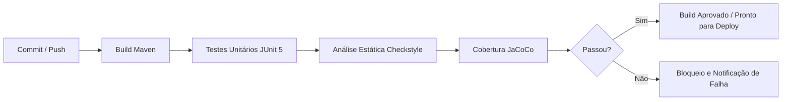

# 🚀 Pipeline de Integração Contínua (CI/CD) e Automação de Qualidade


Repositório dedicado à implementação prática de uma infraestrutura de **Integração Contínua (CI/CD)** em Java utilizando **GitHub Actions** e **Apache Maven**. O projeto automatiza a compilação, a execução de testes unitários, a auditoria de padronização de código (*Quality Gate*) e a geração de relatórios de cobertura a cada `push` ou `pull request`.

## 🏗️ Arquitetura da Pipeline de Qualidade

O fluxo de trabalho automatizado (`.github/workflows/ci.yml`) é disparado automaticamente em eventos de versionamento e executa validações sequenciais em um ambiente Linux (`ubuntu-latest`):



## 🛠️ Estágios e Ferramentas Integradas

| Estágio | Ferramenta / Plugin | Objetivo na Pipeline |
| :--- | :--- | :--- |
| **1. Build** | Apache Maven | Compilação do código-fonte, empacotamento e resolução de dependências. |
| **2. Testes Unitários** | JUnit 5 (Jupiter) & Surefire | Validação automatizada das regras de negócio da aplicação. |
| **3. Quality Gate** | Maven Checkstyle (`sun_checks.xml`) | Análise estática rigorosa de formatação, Javadoc e boas práticas, bloqueando o build em caso de violações. |
| **4. Cobertura** | JaCoCo Maven Plugin | Instrumentação de bytecode e geração de relatório de cobertura de testes. |

## 📂 Estrutura do Projeto

```text
Aula10-CICD/
├── .github/
│   └── workflows/
│       └── ci.yml                      # Definição da pipeline no GitHub Actions
├── src/
│   ├── main/java/org/example/
│   │   ├── package-info.java           # Documentação do pacote exigida pelo Checkstyle
│   │   └── CalculadoraCI.java          # Classe de negócio auditada e documentada
│   └── test/java/org/example/
│       └── CalculadoraCITest.java      # Suíte de testes unitários com JUnit 5
└── pom.xml                             # Configuração de dependências, compilação e plugins
```

## 💻 Como Executar e Auditar Localmente

Para executar localmente a mesma esteira de validação que roda no servidor do GitHub Actions:

```bash
mvn clean test checkstyle:check jacoco:report
```

Após a conclusão com `BUILD SUCCESS`, o relatório visual de cobertura do JaCoCo pode ser consultado abrindo o arquivo `target/site/jacoco/index.html` no navegador.

## 👨‍💻 Autor

Desenvolvido por **Matheus Cândido** — Estudante de Informática para Negócios na **FATEC São Bernardo do Campo (Adib Moisés Dib)**.

[](https://www.linkedin.com/in/matcand)
[](https://github.com/matcand)